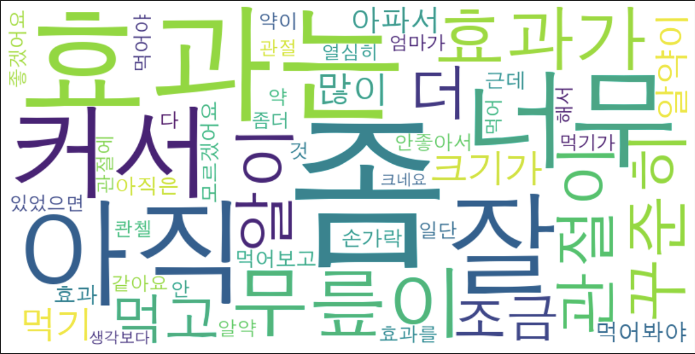

# 01. KoBERT Fine-Tuning & 기업 리뷰 감정 분석

📅 **2024.03 - 2024.06 캡스톤디자인2 프로젝트**

## 📌 프로젝트 개요

AI-HUB의 감정 분석 데이터를 바탕으로 KoBERT 모델을 파인튜닝하고,  
이 모델을 실기업 Q사(관절약품 기업)의 리뷰에 적용해 감정(긍정/부정)을 분류한 프로젝트입니다.

---

## 🧠 핵심 흐름

1. AI-HUB 감정 데이터 전처리
2. 긍정/부정 비율 불균형 해소를 위한 언더샘플링 처리
3. 두 가지 데이터셋으로 각각 KoBERT 파인튜닝 진행
4. 학습된 모델로 콴첼 제품 리뷰 감정 예측
5. 예측 결과 CSV로 저장

---

## 📁 폴더 구성

📁 code/
├── train_kobert_raw.ipynb # 원본 AI-HUB 데이터 학습
├── train_kobert_under.ipynb # 언더샘플링 데이터 학습
├── predict_Q.ipynb # 기업 리뷰 예측
└── undersample_dataset.ipynb # 언더샘플링 처리 코드

📁 data/ (🔒 공개 제외)
├── ai_hub_raw.csv
├── ai_hub_undersampled.csv
└── Q_review.csv

📁 model/ (🔒 공개 제외)
├── kobert_raw.pt
└── kobert_under.pt

📁 results/ (🔒 공개 제외)
└── kobert_raw_predictions.csv
└── wordcloud_negative.png

README.md

---

## ⚙️ 사용 기술

- Python, PyTorch
- KoBERT 사전학습 모델
- HuggingFace Transformers
- Scikit-learn, Pandas

---

## 📊 예측 결과 요약

- 사용 모델: `kobert_raw.pt`
- 예측 대상: Q사 리뷰 4,247건
- 결과 저장: `results/kobert_raw_predictions.csv`
- 추출 키워드 예시: `"크기", "효과 없음"`

> 해당 결과는 이후 Claude API 기반 전략 분석에 활용됩니다.

---

## 🖼️ 시각화 결과 (워드클라우드)

부정으로 분류된 리뷰를 기반으로 생성한 워드클라우드입니다.  
고객의 주요 불만 키워드가 시각적으로 나타나며, 전략 분석 단계에서 활용됩니다.

  

---

## 🔐 데이터/모델 공개 범위 안내

- 모든 데이터와 학습된 모델은 `.gitignore` 처리되어 있습니다.
- 실제 작업 시에는 동일한 구조로 개인 PC 내에서 사용 가능합니다.

---

## 🧩 담당 역할

- 데이터 전처리 및 언더샘플링 설계
- KoBERT 모델 학습 파이프라인 구축
- 실기업 리뷰에 모델 적용 및 결과 저장