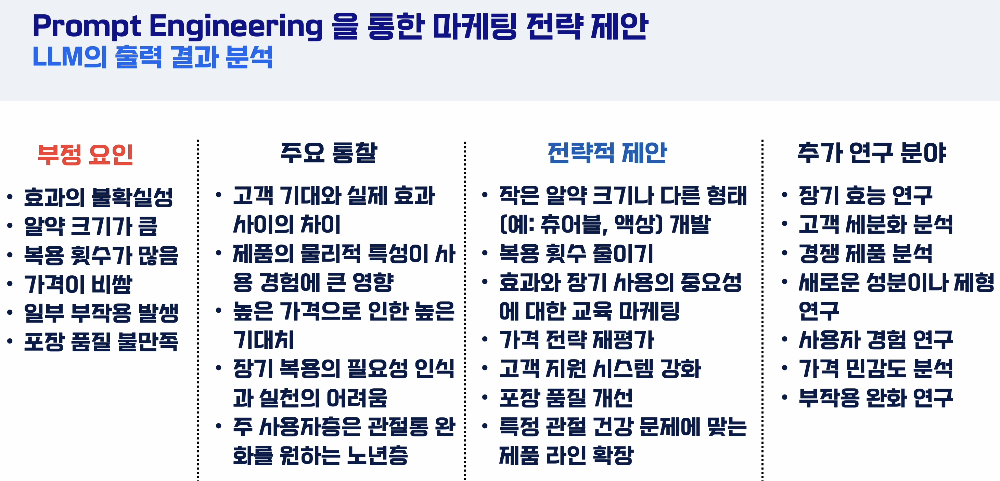

# 04. Claude 기반 부정 리뷰 분석 & 마케팅 전략 도출 (SW 경진대회 출품작)

📅 **2024.07 ~ 2024.08 교내 여름방학 SW 경진대회 출품용 프로젝트**

---

## 📌 개요

본 프로젝트는 KCC 논문에서의 키워드 분석 한계를 넘어서  
**LLM을 직접 활용해 부정 리뷰로부터 실질적인 전략을 생성**해보는 실험입니다.

Claude 3.5 Sonnet API를 활용하여  
- 부정 리뷰 분석  
- 고객 인사이트 도출  
- 전략 제안  
- 후속 연구 방향  
까지 자동으로 생성하도록 프롬프트를 설계했습니다.

---

## 🔍 실험 흐름

1. `kobert_raw.pt`로 전체 리뷰 감정 예측  
2. `AI_HUB_PT_predict == -1` 조건으로 **부정 리뷰 필터링**  
3. Claude API 호출:
   - 리뷰 리스트를 numbered string 형태로 변환  
   - 프롬프트 설계하여 Claude에 전달  
4. Claude 출력 결과를 요약 및 시각화

---

## 🧠 Claude 프롬프트 설계

Claude에게 다음 역할을 부여:

> "Fortune 500 기업의 소비자 전략 분석 전문가"

```python
system="You are a seasoned data scientist at a Fortune 500 company specializing in consumer product analysis and strategic decision-making. Your task is to analyze negative customer reviews and provide strategic recommendations to improve product satisfaction and address customer concerns."

user="Analyze this dataset of negative customer reviews for a health supplement product and provide:

1. A summary of the main issues identified in the reviews.
2. Key insights derived from the analysis.
3. Strategic recommendations for the company to address these issues and improve customer satisfaction.
4. Potential areas for further research or data collection."
```

---

## 📊 분석 결과 요약

📎 Claude LLM의 전략 분석 요약 (슬라이드 형태 정리):



### 🔹 부정 요인:
- 효과 불확실성, 알약 크기, 복용 빈도, 가격 비쌈 등

### 🔹 전략 제안:
- 소형 제형 개발 (츄어블, 액상 등)
- 복용 횟수 감소
- 교육 마케팅
- 가격 전략 재평가
- 고객지원 강화 및 제품 라인 확대

---

## 🔐 API 사용 안내

- 본 프로젝트는 `anthropic`의 Claude 3.5 Sonnet API를 사용합니다.  
- 실행을 위해 `.env` 파일에 다음 환경변수를 설정해야 합니다:

```
ANTHROPIC_API_KEY=your_api_key
```

- 해당 API 키는 깃허브에 포함되지 않으며, 직접 발급이 필요합니다.

---

## 🏁 결과 및 한계

- 교내 여름방학 SW 경진대회 참가작으로 제출  
- 수상은 하지 못했지만, **실제 LLM을 활용해 전략을 자동 생성**해본 의미 있는 실험이었음  
- Claude의 응답을 모두 영어로 출력하였기에 결과 이미지의 내용은 따로 번역을 한 것

---

## 🙋🏻 담당 역할

- KoBERT 기반 부정 리뷰 필터링  
- Claude API 연동 및 프롬프트 설계  
- LLM 응답 요약 및 슬라이드 작성  
- 전체 결과 정리 및 전략 도출 흐름 설계
